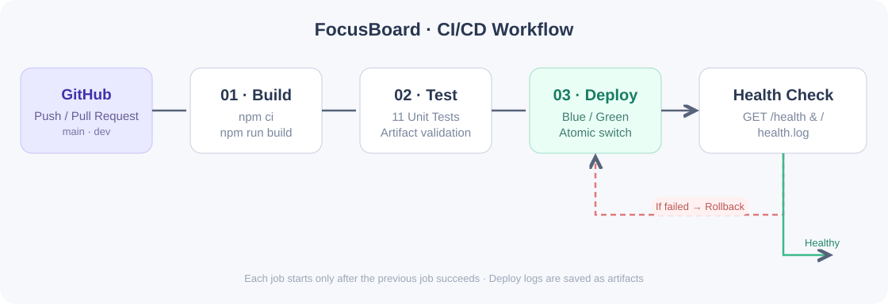
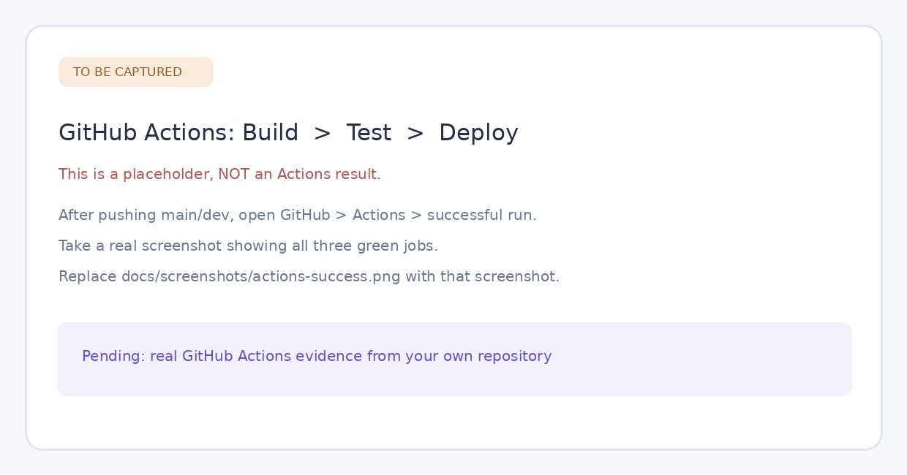
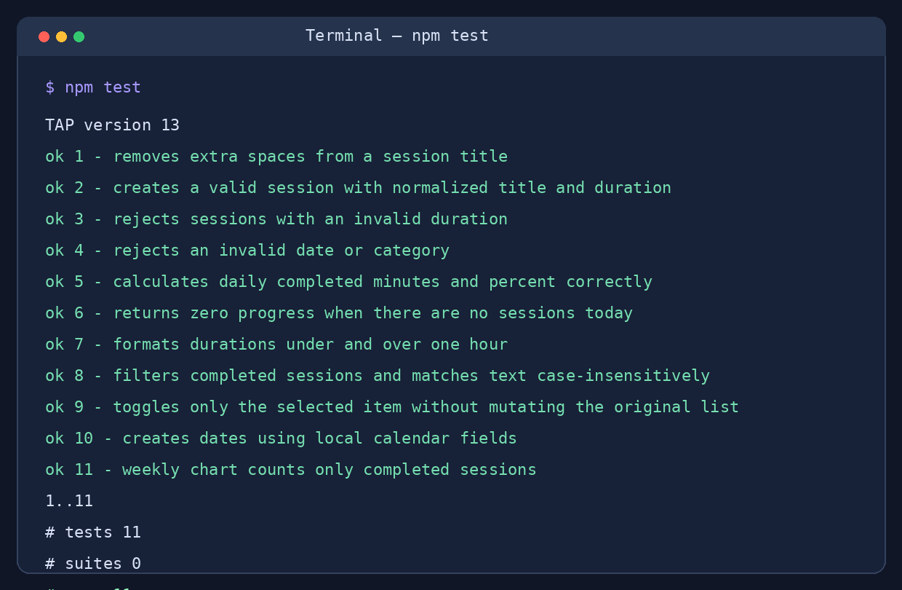
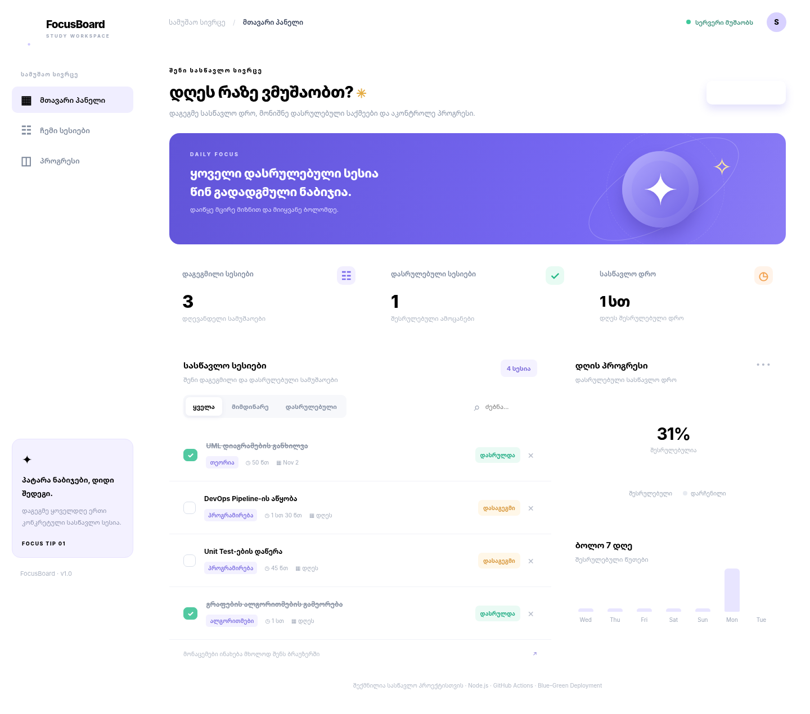
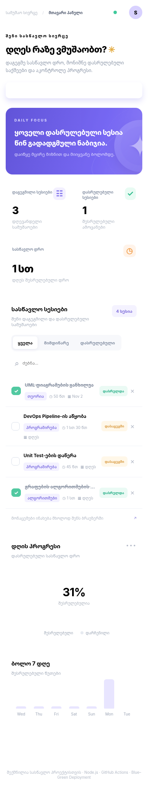

# FocusBoard — Study Session Tracker

**შუალედური პროექტი · DevOps Pipeline**

FocusBoard არის პატარა ვებაპლიკაცია სწავლის დასაგეგმად. მომხმარებელს შეუძლია დაამატოს სასწავლო სესიები, მიუთითოს მათი ხანგრძლივობა და კატეგორია, მონიშნოს დასრულებულად, მოძებნოს ან წაშალოს. პანელი აჩვენებს დღევანდელ პროგრესს და ბოლო 7 დღის შესრულებულ დროს.

პროექტი შეგნებულად არის გაკეთებული მარტივი ტექნოლოგიებით — დამატებითი frontend framework-ის გარეშე, რათა ძირითადი ყურადღება **CI/CD ავტომატიზაციას** დაეთმოს.

## გამოყენებული ტექნოლოგიები

- **HTML, CSS, JavaScript (ES Modules)** — ინტერფეისი და ძირითადი ლოგიკა;
- **Node.js 22** — Build პროცესი, HTTP სერვერი და ჩაშენებული Unit Test runner;
- **Git / GitHub** — ვერსიების კონტროლი (`main`, `dev`);
- **GitHub Actions** — სამი თანმიმდევრული Job: `Build → Test → Deploy`;
- **Bash, curl** — Blue–Green Deployment, Health Check და ავტომატური Rollback;
- **localStorage** — სასწავლო სესიების შენახვა ბრაუზერში (ბაზა არ სჭირდება).

აპლიკაციას აქვს სამი ძირითადი ფუნქციური ბლოკი: **სესიების მართვა**, **სტატისტიკის გამოთვლა** და **სესიის ფილტრაცია/ძებნა**. შესამოწმებელი ლოგიკა გამოყოფილია `public/js/core.js` ფაილში.

## 1. აპლიკაციის გაშვება

საჭიროა Node.js **20 ან უფრო ახალი** (რეკომენდებულია 22) და `npm`.

```bash
npm ci
npm run build
npm start
```

ბრაუზერში გახსენით **http://127.0.0.1:4173**. პირველი გახსნისას გამოჩნდება რამდენიმე სანიმუშო სესია. შემდეგ შეტანილი ცვლილებები ინახება იმავე ბრაუზერში `localStorage`-ით.

ტესტების გასაშვებად:

```bash
npm test
```

ლოკალური დეპლოიმენტისა და Health Check-ის გასაშვებად (Linux/macOS ან Git Bash Windows-ზე):

```bash
npm run build
bash scripts/deploy.sh
bash scripts/health-check.sh
```

> `npm start` ემსახურება ჩვეულებრივ `dist/` საქაღალდეს, ხოლო `deploy.sh` ქმნის ცალკე `.deployment/` სამუშაო გარემოს და თვითონვე რთავს სერვერს, თუ ის ჯერ არ მუშაობს. გამოიყენეთ **ერთი მეთოდი ერთ პორტზე**, რომ პორტის კონფლიქტი არ წარმოიშვას.

## 2. CI/CD Pipeline — სამი საფეხური

Workflow-ის ფაილი: [`.github/workflows/pipeline.yml`](.github/workflows/pipeline.yml)

Pipeline ავტომატურად იშვება `push`-ზე და `pull_request`-ზე, როგორც `main`, ისე `dev` branch-ისთვის. ასევე შეიძლება ხელით გაშვება `workflow_dispatch`-ით.

| Job | როდის იწყება | რას აკეთებს |
| --- | --- | --- |
| **1 · Build** | Push / PR | რეპოზიტორიის ჩამოტვირთვა, Node.js 22-ის გამართვა, `npm ci`, `npm run build`, `dist/` artifact-ის შენახვა. |
| **2 · Test** | მხოლოდ წარმატებული Build-ის შემდეგ | 11 ავტომატური Unit Test-ის გაშვება (`npm test`) და აწყობილი ფაილების შემოწმება (`scripts/check-dist.mjs`). |
| **3 · Deploy** | მხოლოდ წარმატებული Test-ის შემდეგ | არტეფაქტის ჩამოტვირთვა, Blue–Green ლოკალური დეპლოიმენტი, HTTP Health Check და ლოგების ატვირთვა. სურვილის შემთხვევაში, `main` branch-იდან Vercel-ზეც დეფლოი. |

`needs: build` და `needs: test` იცავს საფეხურების სწორ რიგს. თუ Build ან Test ვერ შესრულდა, შემდეგი Job აღარ გაეშვება. წარმატების/შეცდომის ლოგები ინახება GitHub Actions-ის `deployment-logs` artifact-ში.

### Workflow diagram



## 3. Deployment და Rollback

ძირითადი არჩეული მეთოდია **გზა A — ლოკალური Blue–Green Deployment**.

სკრიპტი `scripts/deploy.sh` იყენებს ასეთ საქაღალდეებს:

```text
.deployment/
├── blue/             # პირველი ვერსია
├── green/            # მეორე ვერსია
├── active -> green   # მიმდინარე ვერსიის სიმბოლური ბმული
└── logs/
    ├── deploy.log
    ├── health.log
    └── server.log
```

ყოველი ახალი დეპლოიმენტისას ფაილები გადადის არაქტიურ (`blue` ან `green`) საქაღალდეში. შემდეგ `active` სიმბოლური ბმული ატომურად გადაერთვება ახალ ვერსიაზე. HTTP სერვერი ყოველ მოთხოვნაზე ამ ბმულიდან კითხულობს ფაილებს. **თუ Health Check ვერ გაივლის, ავტომატურად აღდგება წინა `active` ვერსია.**

Rollback-ის შესამოწმებლად, ორი წარმატებული დეპლოიმენტის შემდეგ შესაძლებელია კონტროლირებადი შეცდომის გამოწვევა:

```bash
FORCE_HEALTH_FAIL=1 bash scripts/deploy.sh
```

ეს ბრძანება შეგნებულად მთავრდება შეცდომით, აბრუნებს წინა ვერსიას და წერს `ROLLBACK` ჩანაწერს `deploy.log`-ში. ჩვეულებრივ გაშვებაზე `FORCE_HEALTH_FAIL` არ გამოიყენება.

**მნიშვნელოვანი გარემოს შენიშვნა:** `ubuntu-latest` GitHub-hosted runner დროებითია. მასზე Deploy Job რეალურად ქმნის/გადადებს ფაილებს, რთავს სერვერს და ამოწმებს URL-ს, თუმცა სამუშაო გარემო Job-ის დასრულების შემდეგ იშლება. მუდმივი ლოკალური production გარემოსთვის გამოიყენეთ საკუთარი **self-hosted runner/VM** (ინსტრუქცია ქვემოთ), ან სურვილისამებრ Vercel.

### მუდმივი local server / self-hosted runner (სურვილისამებრ)

საკუთარ Linux/VM-ზე დააინსტალირეთ GitHub Actions self-hosted runner და მისცეთ წვდომა production საქაღალდეზე. GitHub რეპოზიტორიის **Settings → Secrets and variables → Actions → Variables** დაამატეთ:

- `DEPLOY_RUNNER = self-hosted`
- `DEPLOY_DIR = /opt/focusboard-production` (შეიძლება ნებისმიერი მუდმივი, ჩასაწერი absolute path)

სერვერის მუდმივად გასაშვებად მოცემულია `deploy/focusboard.service.example` (შესაბამისი `ExecStart` გზა შეცვალეთ). ამ შემთხვევაში `.deployment/active`-ის ნაცვლად გამოიყენება `/opt/focusboard-production/active`. `systemd`-ის სერვერი ცალკე მუშაობს და GitHub Actions-ის დასრულების შემდეგაც რჩება ჩართული.

### Vercel — დამატებითი cloud შესაძლებლობა

თუ გსურთ საჯარო მუდმივი URL, შექმენით Vercel პროექტი და GitHub repository Secrets-ში დაამატეთ `VERCEL_TOKEN`, `VERCEL_ORG_ID`, `VERCEL_PROJECT_ID`. ამის შემდეგ `main`-ზე ყოველი `push` Deploy Job-ში ავტომატურად გამოიძახებს Vercel CLI-ს და გადაამოწმებს მიღებულ URL-ს. კონფიგურაცია არის `public/vercel.json`-ში; `/health` Vercel-ზე უკავშირდება `/health.json` ფაილს. Secret-ების გარეშე **ძირითადი ლოკალური Pipeline მაინც მუშაობს**.

## 4. Monitoring & Health Check

`scripts/health-check.sh` `curl`-ით ამოწმებს ორივეს:

1. `GET /health` აბრუნებს HTTP `200`-ს და JSON-ს `"status":"ok"`;
2. `GET /` აბრუნებს HTTP `200`-ს და FocusBoard-ის HTML გვერდს.

ლოგების მაგალითი:

```text
2026-11-03T07:06:08Z | UP | health=200 | page=200 | http://127.0.0.1:4173
2026-11-03T07:06:13Z | ROLLBACK | restored green
```

რეალურ გაშვებაში Health Check-ის შედეგი იწერება `.deployment/logs/health.log` ფაილში, ხოლო რელიზის გადართვა და Rollback — `.deployment/logs/deploy.log` ფაილში. აპლიკაციის ზედა მარჯვენა მხარეს არსებული **სერვერის სტატუსი** არის დამატებითი პატარა ვიზუალური მონიტორინგი, რომელიც `/health` endpoint-ს 45 წამში ერთხელ ამოწმებს.

## 5. ტესტები და მტკიცებულებები

### GitHub Actions — Build, Test, Deploy



**ყურადღება:** ზემოთ მოცემული სურათი განზრახ არის *placeholder*, არა გაყალბებული GitHub Actions-ის შედეგი. საკუთარი საჯარო რეპოზიტორიის შექმნისა და პირველი წარმატებული გაშვების შემდეგ საჭიროა მისი შეცვლა ნამდვილი სქრინშოტით (`docs/screenshots/actions-success.png`). უნდა ჩანდეს სამი მწვანე Job: `1 · Build`, `2 · Test`, `3 · Deploy (Blue/Green)`.

### Unit Test-ის წარმატებული გაშვება



**შედეგი:** 11 ტესტი გავიდა წარმატებით, ჩავარდნილი — 0. სრული ტექსტური შედეგი: [`docs/test-output.txt`](docs/test-output.txt). ტესტები ამოწმებს სესიის შექმნას, მონაცემების ვალიდაციას, დღიურ სტატისტიკას, ხანგრძლივობის ფორმატირებას, ფილტრაციას, სტატუსის შეცვლასა და კვირის მონაცემებს.

### მომუშავე აპლიკაცია



**აპლიკაციის ხედი:** სესიების მართვა, დღიური სტატისტიკა, პროგრესის დიაგრამა და ზედა მარჯვენა კუთხეში სერვერის სტატუსი. ადგილობრივი HTTP სერვერი ცალკე შემოწმდა `curl`-ით; ეს ეკრანის ხედი შექმნილია იგივე HTML/CSS/JS ფაილების ბრაუზერში რენდერით. რეპოზიტორიის გამოქვეყნების შემდეგ შეგიძლიათ ჩაანაცვლოთ თქვენი ლოკალური ბრაუზერიდან გადაღებული სურათით.

მობილური ადაპტაცია:



## 6. ფაილების სტრუქტურა

```text
FocusBoard-DevOps/
├── .github/workflows/pipeline.yml    # GitHub Actions Pipeline
├── public/
│   ├── index.html                    # ვებგვერდი
│   ├── styles.css                    # დიზაინი
│   ├── js/app.js                     # UI და localStorage
│   ├── js/core.js                    # სუფთა ფუნქციები ტესტირებისთვის
│   ├── health.json                   # Vercel static health endpoint
│   └── vercel.json                   # Vercel route
├── scripts/
│   ├── build.mjs                     # Build
│   ├── check-dist.mjs                # Artifact validation
│   ├── server.mjs                    # Local HTTP server + /health
│   ├── deploy.sh                     # Blue–Green + Rollback
│   └── health-check.sh               # Monitoring
├── tests/core.test.mjs              # 11 Unit Tests
├── docs/
│   ├── workflow.svg                  # Workflow diagram
│   └── screenshots/                 # README-ის სურათები
├── deploy/focusboard.service.example
├── package.json
├── package-lock.json
└── README.md
```

`dist/` და `.deployment/` გენერირდება ავტომატურად; ორივე დამატებულია `.gitignore`-ში. დამატებითი PDF ან სხვა დოკუმენტი საჭირო არ არის.

## 7. Git / GitHub-ზე გამოქვეყნება

პროექტს აქვს ორი branch — `main` (სტაბილური ვერსია) და `dev` (განვითარების branch). ისტორია შეიცავს ლოგიკურ commit-ებს და `dev`-იდან `main`-ში merge-ს.

1. GitHub-ზე შექმენით **საჯარო და ცარიელი** რეპოზიტორია სახელით `focusboard-devops` (**არ დაამატოთ** ახალი README, `.gitignore` ან License — ისინი უკვე არის პროექტში).
2. ZIP ფაილიდან გახსენით პროექტის საქაღალდე ტერმინალში (Git Bash / VS Code Terminal). `.git` საქაღალდე პროექტის ნაწილად არის შენახული.
3. შეასრულეთ ბრძანებები, სადაც `YOUR_USERNAME` შეცვალეთ საკუთარი GitHub-ის სახელით:

```bash
git remote add origin https://github.com/YOUR_USERNAME/focusboard-devops.git
git push -u origin main
git push -u origin dev
```

4. GitHub → **Actions** → `FocusBoard CI/CD` → აირჩიეთ მწვანე წარმატებული გაშვება. უნდა ჩანდეს ყველა სამი Job. გადაიღეთ სქრინშოტი და ჩაანაცვლეთ `docs/screenshots/actions-success.png`.
5. ატვირთეთ განახლებული სურათი GitHub-ზე (შეგიძლიათ ვებინტერფეისიდანაც), ან ლოკალურად:

```bash
git add docs/screenshots/actions-success.png
git commit -m "docs: add successful Actions pipeline screenshot"
git push origin main
```

6. დარწმუნდით, რომ README-ში ყველა სურათი ჩანს და ბოლო commit **დედლაინამდე** არის შესრულებული. საბოლოოდ სასწავლო სისტემაში ჩასვით მხოლოდ საჯარო რეპოზიტორიის URL, მაგალითად `https://github.com/YOUR_USERNAME/focusboard-devops`.

---

**გამოცდაზე მოკლე ახსნა:** პროექტის Build ეტაპი ამზადებს სტატიკურ ვებაპლიკაციას და გადასცემს artifact-ს; Test ამოწმებს ბიზნესლოგიკასა და build-ს; Deploy იყენებს Blue–Green სტრატეგიას, Health Check-ს და შეცდომის შემთხვევაში წინა ვერსიას აბრუნებს. ეს არის DevOps Pipeline-ის მთავარი იდეა — ავტომატიზებული და შემოწმებადი მიწოდება.
